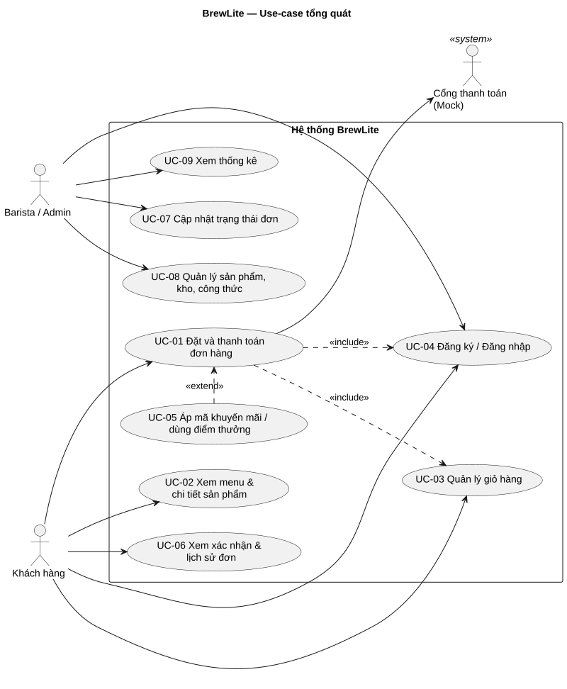

# BrewLite — Đặc tả yêu cầu phần mềm rút gọn (SRS) — Task 1.2

## Yêu cầu chức năng

| Mã | Yêu cầu | MoSCoW | Tiêu chí chấp nhận (kiểm chứng được) |
| :--- | :--- | :-: | :--- |
| **FR-01** | Hiển thị menu đồ uống kèm hình, tên, giá; cho phép tìm/lọc theo danh mục. | Must | `GET /products` trả 200 và danh sách `products` (id, name, price, imageUrl). Menu hiển thị lưới sản phẩm; có trạng thái loading, empty ("Không tìm thấy…") và error. |
| **FR-02** | Xem chi tiết sản phẩm; chọn size (S/M/L), topping, mức đường, mức đá, ghi chú; giá tự cập nhật theo tùy chọn. | Must | `GET /products/:id` trả 200 với sản phẩm hợp lệ, 404 với id không tồn tại. Giá đơn vị = giá gốc + phụ thu size (S 0, M 6.000, L 12.000) + tổng giá topping. |
| **FR-03** | Giỏ hàng: thêm, sửa số lượng, xóa; tự tính tổng tiền; hiển thị badge số lượng. | Must | Thêm sản phẩm → badge tăng; đổi số lượng → tổng tiền cập nhật; số lượng = 0 thì dòng bị xóa; tải lại trang vẫn giữ giỏ hàng. |
| **FR-04** | Đăng ký và đăng nhập bằng email/mật khẩu; phát JWT; chỉ người đã đăng nhập mới đặt đơn. | Must | `POST /auth/register` tạo tài khoản (mật khẩu băm bcrypt, email duy nhất, mật khẩu ≥ 6 ký tự). `POST /auth/login` đúng thông tin trả `accessToken`, sai trả 401. Gọi `POST /orders` không có JWT trả 401. Khách chưa đăng nhập bấm thanh toán bị chuyển tới `/login`. |
| **FR-05** | Tạo đơn hàng từ giỏ hàng, lưu ở trạng thái PENDING, trả mã đơn. | Must | `POST /orders` với giỏ hợp lệ trả 201, `status = PENDING`, có `orderCode`. Giỏ rỗng/số lượng < 1/topping không hợp lệ trả 400. Tổng tiền do server tính lại, không tin giá từ client. |
| **FR-06** | Kiểm soát nguyên liệu: tự động trừ kho nguyên liệu theo công thức BOM khi barista nhận đơn (PREPARING). Món không quản lý tồn kho theo ly. | Must | Chuyển đơn sang PREPARING → kho nguyên liệu bị trừ theo BOM × số lượng, ghi `InventoryTransaction`; món có `isAvailable = false` bị từ chối khi đặt (400). |
| **FR-07** | Thanh toán không tiền mặt bằng Ví hoặc Thẻ (mô phỏng). | Must | `POST /payments` với `method` ∈ {WALLET, CARD}: thành công → payment `SUCCESS`, đơn `PAID`. Lỗi mô phỏng → payment `FAILED`, đơn `PAYMENT_FAILED`, giỏ hàng phía client được giữ nguyên, cho phép thử lại. |
| **FR-08** | Thanh toán idempotent: cùng `Idempotency-Key` không xử lý hai lần. | Must | Gửi 2 lần cùng `Idempotency-Key` → chỉ tồn tại 1 bản ghi payment, đơn chỉ chuyển PAID một lần, điểm thưởng chỉ cộng một lần; lần 2 trả `idempotentReplay = true`. Thiếu key → 400. |
| **FR-09** | Hiển thị xác nhận đơn (mã đơn, trạng thái, tổng tiền) và lịch sử đơn của người dùng. | Must | Sau khi PAID hiển thị màn hình xác nhận có mã đơn và trạng thái. `GET /orders/me` chỉ trả đơn của người đang đăng nhập, mới nhất trước. Người dùng không xem được đơn của người khác (403). |
| **FR-10** | Quản lý trạng thái đơn theo máy trạng thái: PENDING → PAID → PREPARING → READY → COMPLETED; nhánh PAYMENT_FAILED, CANCELLED; chặn chuyển sai. | Must | `PATCH /orders/:id/status` chỉ cho `ADMIN`. Chuyển hợp lệ trả 200; chuyển sai (ví dụ COMPLETED → PAID) trả 400; COMPLETED và CANCELLED không chuyển được tiếp. |
| **FR-11** | Áp mã khuyến mãi hợp lệ. | Should | `POST /promotions/apply`: mã đúng, chưa hết hạn, đơn ≥ giá trị tối thiểu → giảm `min(subtotal×%, mức giảm tối đa)`. Mã sai trả 404; hết hạn hoặc chưa đủ giá trị đơn trả 400. |
| **FR-12** | Điểm thưởng: dùng điểm để giảm giá khi đặt đơn; cộng điểm sau khi đơn PAID. | Should | 1 điểm = 1đ giảm, không vượt số điểm hiện có hoặc tổng tiền. Đơn PAID cộng 5% tổng tiền vào `loyaltyPoints` và ghi `LoyaltyTransaction`. Hủy đơn hoàn lại điểm đã dùng. |
| **FR-13** | Hủy đơn và hoàn điểm thưởng. | Should | Admin chuyển đơn PENDING/PAYMENT_FAILED/PAID sang CANCELLED → điểm thưởng đã dùng được hoàn lại. |
| **FR-14** | Admin quản lý sản phẩm (thêm/sửa/xóa) và xem danh sách đơn. | Should | Các endpoint `POST/PATCH/DELETE /products`, `GET /admin/orders` trả 403 với `CUSTOMER`, hoạt động với `ADMIN`. |
| **FR-15** | Quản lý kho nguyên liệu và công thức pha chế (BOM); tự trừ kho khi đơn chuyển PREPARING. | Could | Đơn chuyển PREPARING → nguyên liệu giảm đúng `quantityNeeded × số lượng`, ghi `InventoryTransaction` loại `ORDER_DEDUCT`; không trừ lặp (`inventoryDeducted`). |
| **FR-16** | Admin xem thống kê doanh thu và phân bổ trạng thái đơn. | Could | `GET /admin/stats` trả tổng doanh thu và số đơn theo trạng thái; chỉ `ADMIN` truy cập được. |
| **FR-17** | Thanh toán bằng cổng thật (Momo/VNPay/Stripe). | Won't | Ngoài phạm vi (xem context-and-scope §3.3). |
| **FR-18** | Giao hàng tận nơi; thông báo đẩy. | Won't | Ngoài phạm vi MVP. |

## Yêu cầu phi chức năng

| Mã | Nhóm | Yêu cầu | MoSCoW | Tiêu chí chấp nhận |
| :--- | :--- | :--- | :-: | :--- |
| **NFR-01** | Hiệu năng | Thời gian phản hồi API < 500 ms với dữ liệu mẫu. | Must | Đo bằng smoke/E2E: `GET /products`, `POST /orders`, `POST /payments` đều < 500 ms ở p95 trên môi trường local với seed mặc định. |
| **NFR-02** | Bảo mật | Mật khẩu được băm (bcrypt); không lưu/ghi log mật khẩu thô. | Must | Cột `passwordHash` không chứa mật khẩu gốc; hash bắt đầu bằng `$2`. |
| **NFR-03** | Bảo mật | Xác thực bằng JWT; phân quyền theo vai trò (RBAC). | Must | Endpoint Admin trả 403 với CUSTOMER, 401 khi thiếu/sai token. |
| **NFR-04** | Bảo mật | Validate dữ liệu đầu vào ở backend (class-validator, whitelist) và frontend. | Must | Dữ liệu sai định dạng bị từ chối 400 kèm thông báo rõ ràng. |
| **NFR-05** | Bảo mật | Secret (JWT secret, mật khẩu DB) không nằm trong repository và log CI; CSDL không public ra Internet ở production. | Must | Quét repository không thấy secret thật; DB production chỉ truy cập được từ mạng nội bộ. |
| **NFR-06** | Toàn vẹn dữ liệu | Tạo đơn, trừ kho, trừ điểm thực hiện trong một transaction; thanh toán + cập nhật đơn + cộng điểm là nguyên tử. | Must | Lỗi giữa chừng không để lại đơn/kho/điểm ở trạng thái dở dang (test đồng thời + idempotency). |
| **NFR-07** | Tính khả dụng (Usability) | Giao diện mobile-first, dùng được ở màn hình ≥ 360 px; hiển thị loading/lỗi cơ bản; chạy trên Chrome, Edge, Firefox, Safari hiện đại. | Must | Kiểm tra thủ công ở viewport 360 px và các trình duyệt trên; có `manifest.json` cho PWA. |
| **NFR-08** | Tính khả dụng (Availability) | Cung cấp health check phản ánh trạng thái API và kết nối DB. | Must | `GET /health` trả 200 `{status:"ok", database:"up"}`; trả 503 khi mất DB. |
| **NFR-09** | Khả năng triển khai | Chạy toàn bộ hệ thống (web, API, DB) bằng một lệnh `docker compose up`; migration/seed tái tạo được DB. | Must | Người ngoài nhóm clone repo, làm theo README và truy cập được web ở `localhost:3000`. |
| **NFR-10** | Khả năng triển khai | CI/CD tự động: lint → test → build → image → deploy → smoke test; có cách rollback. | Must | Pipeline xanh trên GitHub Actions; pipeline dừng khi lỗi. |
| **NFR-11** | Bảo trì/Kiểm thử | Có unit test cho nghiệp vụ quan trọng, integration test cho tạo đơn/thanh toán và ít nhất một E2E menu → xác nhận đơn. | Must | `npm test` và `npm run test:e2e` chạy qua. |
| **NFR-12** | Khả năng mở rộng | Backend chia module theo domain (auth, products, orders, payments, promotions, admin). | Should | Mỗi domain là một NestJS module độc lập. |
| **NFR-13** | Khả năng sử dụng | PWA đầy đủ (service worker, offline). | Could | Cài được app lên màn hình chính và mở menu khi offline. |

## Use-case tổng quát

Nguồn: [`usecase-overview.puml`](../diagrams/usecase-overview.puml)
