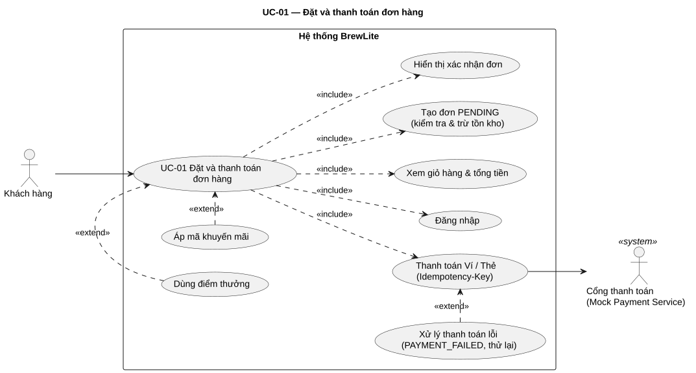

# UC-01 — Đặt và thanh toán đơn hàng (Task 1.3)

## 1. Use-case diagram

Nguồn: [`usecase-place-and-pay.puml`](../diagrams/usecase-place-and-pay.puml)

## 2. Thông tin chung

| Mục | Nội dung |
| :--- | :--- |
| **Tên** | Đặt và thanh toán đơn hàng |
| **Actor chính** | Khách hàng (đã đăng nhập, role `CUSTOMER`) |
| **Actor phụ** | Cổng thanh toán (Mock Payment Service) |
| **Mục tiêu** | Khách đặt đồ uống trong giỏ hàng và thanh toán không tiền mặt, nhận mã đơn xác nhận. |
| **Trigger** | Khách bấm "Thanh toán" ở màn hình giỏ hàng. |
| **Yêu cầu liên quan** | FR-03, FR-04, FR-05, FR-06, FR-07, FR-08, FR-09, FR-11, FR-12, NFR-01, NFR-03, NFR-04, NFR-06 |

## 3. Tiền điều kiện

1. Giỏ hàng có ít nhất 1 sản phẩm.
2. Khách đã đăng nhập và có JWT còn hạn (nếu chưa, xem luồng thay thế A1).
3. Các sản phẩm trong giỏ đang được bán (`isAvailable`).

## 4. Hậu điều kiện

**Thành công:**
- Có 1 đơn hàng với `status = PAID`, 1 bản ghi payment `SUCCESS`.
- Tồn kho sản phẩm đã giảm theo số lượng; điểm đã dùng bị trừ; điểm thưởng 5% tổng tiền được cộng cho khách và ghi `LoyaltyTransaction`.
- Giỏ hàng được xóa; khách thấy màn hình xác nhận có mã đơn.

**Thất bại (thanh toán lỗi):**
- Đơn ở `PAYMENT_FAILED`, có payment `FAILED`; không cộng điểm thưởng; giỏ hàng phía client được giữ nguyên; khách có thể thử lại.

**Thất bại (hết hàng / dữ liệu sai):** không tạo đơn, không đổi tồn kho, không trừ điểm.

## 5. Luồng chính

| Bước | Actor | Hành động |
| :-: | :--- | :--- |
| 1 | Khách hàng | Bấm "Thanh toán" trong giỏ hàng; hệ thống hiển thị tổng tiền. |
| 2 | Khách hàng | Chọn cách nhận (tại quầy), nhập ghi chú, (tùy chọn) nhập mã khuyến mãi / số điểm muốn dùng. |
| 3 | Khách hàng | Chọn phương thức thanh toán: Ví điện tử hoặc Thẻ ngân hàng, bấm xác nhận. |
| 4 | Hệ thống (UI) | Gửi `POST /orders` kèm JWT và nội dung giỏ hàng. |
| 5 | Hệ thống (API) | Kiểm tra JWT và validate dữ liệu (DTO). |
| 6 | Hệ thống (API) | Mở transaction: với mỗi sản phẩm kiểm tra còn bán, đủ tồn kho; trừ tồn kho bằng optimistic locking (`version`). |
| 7 | Hệ thống (API) | Tính giá từ DB (giá gốc + phụ thu size + topping), áp khuyến mãi, trừ điểm thưởng đã dùng. |
| 8 | Hệ thống (API) | Tạo đơn `PENDING` cùng các dòng đơn; commit transaction; trả mã đơn. |
| 9 | Hệ thống (UI) | Sinh `Idempotency-Key` duy nhất, gửi `POST /payments` (orderId, method) kèm JWT. |
| 10 | Hệ thống (API) | Kiểm tra `Idempotency-Key` chưa tồn tại; mở transaction, kiểm tra quyền sở hữu đơn và `assertTransition(PENDING → PAID)`. |
| 11 | Cổng thanh toán | Xử lý giao dịch (mô phỏng) và trả kết quả thành công. |
| 12 | Hệ thống (API) | Tạo payment `SUCCESS`, cập nhật đơn `PAID`, cộng điểm thưởng, ghi `LoyaltyTransaction`; commit. |
| 13 | Hệ thống (UI) | Xóa giỏ hàng, hiển thị màn hình xác nhận: mã đơn, trạng thái PAID, tổng tiền. |
| 14 | Khách hàng | Xem xác nhận và nhận đồ uống tại quầy khi đơn READY. |

## 6. Luồng thay thế

| Mã | Điều kiện | Xử lý |
| :-: | :--- | :--- |
| **A1** | Chưa đăng nhập ở bước 1 | UI chuyển tới `/login?redirect=/checkout`; sau khi đăng nhập quay lại thanh toán, giỏ hàng vẫn còn. |
| **A2** | Khách nhập mã khuyến mãi (bước 2) | UI gọi `POST /promotions/apply` để xem trước mức giảm; mã hợp lệ → tổng tiền cập nhật. |
| **A3** | Khách dùng điểm thưởng (bước 2) | Số điểm dùng ≤ min(điểm hiện có, tổng sau khuyến mãi); trừ khi tạo đơn, ghi giao dịch `REDEEM`. |
| **A4** | Gửi lại yêu cầu thanh toán với cùng `Idempotency-Key` (mất mạng, bấm đúp) ở bước 9 | API trả lại kết quả cũ (`idempotentReplay = true`), không tạo payment/trừ tiền/cộng điểm lần nữa. |
| **A5** | Khách quay lại đơn PENDING / PAYMENT_FAILED chưa trả tiền | Có thể thanh toán lại bằng `Idempotency-Key` mới (PAYMENT_FAILED → PAID hợp lệ). |
| **A6** | Xung đột optimistic lock ở bước 6 | API tự thử lại tối đa 5 lần với độ trễ tăng dần; nếu vẫn thất bại chuyển sang E1. |

## 7. Luồng ngoại lệ

| Mã | Điều kiện | Xử lý / kết quả |
| :-: | :--- | :--- |
| **E1** | Hết hàng / không đủ tồn kho (bước 6) | Rollback transaction; trả 409; UI báo "không đủ tồn kho", giữ nguyên giỏ để khách chỉnh. |
| **E2** | Sản phẩm ngừng bán hoặc topping không hợp lệ | Rollback; trả 400; UI hiển thị lỗi. |
| **E3** | Giỏ rỗng, số lượng < 1, dữ liệu sai định dạng (bước 5) | Trả 400 với thông báo validate. |
| **E4** | JWT thiếu/hết hạn/sai (bước 5, 10) | Trả 401; UI chuyển tới đăng nhập. |
| **E5** | Mã khuyến mãi sai / hết hạn / chưa đủ giá trị đơn | Trả 404 hoặc 400; đơn không được tạo; khách sửa hoặc bỏ mã. |
| **E6** | Thanh toán thất bại (bước 11) | Tạo payment `FAILED`, đơn → `PAYMENT_FAILED`; không cộng điểm; UI báo lỗi, giữ giỏ hàng, cho phép thử lại hoặc đổi phương thức. |
| **E7** | Thiếu `Idempotency-Key` (bước 9) | Trả 400, không xử lý thanh toán. |
| **E8** | Đơn không thuộc về người gọi (bước 10) | Trả 403. |
| **E9** | Đơn không ở trạng thái cho phép thanh toán (ví dụ đã PAID/CANCELLED) | `assertTransition` ném lỗi, trả 400. |
| **E10** | Lỗi hệ thống/DB giữa chừng | Transaction rollback, không có dữ liệu dở dang; UI báo lỗi chung. |

## 8. Ngoài phạm vi use-case

Hệ thống **không** xử lý tiền thật, hoàn tiền, giao hàng tận nơi hay thanh toán tiền mặt; việc pha chế và chuyển trạng thái PREPARING/READY/COMPLETED thuộc UC-07.

## 9. Truy vết sang tiêu chí chấp nhận (dùng viết test)

| Kịch bản | Mã | Kết quả mong đợi |
| :--- | :-: | :--- |
| Luồng chính | FR-05, FR-07, FR-09 | Đơn `PAID`, có mã đơn, payment `SUCCESS` |
| A4 | FR-08 | Chỉ 1 payment, `idempotentReplay = true` |
| E1 / A6 | FR-06 | 409, tồn kho không âm |
| E6 | FR-07 | Đơn `PAYMENT_FAILED`, giỏ hàng giữ nguyên |
| E4 | FR-04, NFR-03 | 401 |
| E9 | FR-10 | 400, trạng thái đơn không đổi |
